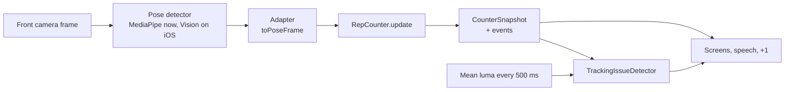
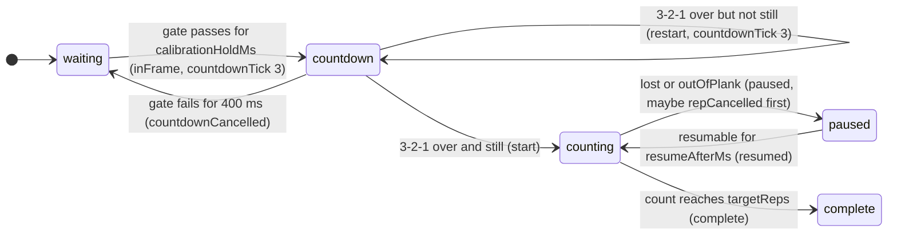
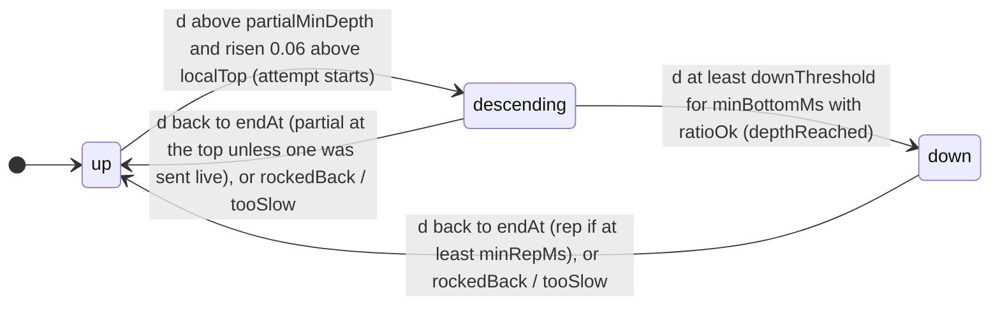

# How push-ups are counted: port reference

This is the reference for porting the web prototype's push-up counter to
Swift + Apple Vision. It covers `web-prototype/src/core/*.ts` (the counter),
`web-prototype/src/platform/mediapipeMapping.ts` (detector output to counter
input) and `web-prototype/src/sim/pushupSimulator.ts` (the simulated person
used by the tests and the demo).

- **The TypeScript source and its tests are the authority.** If this
  document and the code disagree, the code wins (please fix this document).
  Every value and rule below was checked against the code.
- **Prove the port with the golden fixtures** (section 15): 16 JSON files
  with exact input frames and the web counter's exact output for every
  frame. When every file matches, the Swift counter counts exactly like the
  web one.
- Quoted text in *"italics with quotes"* is copied from code comments: it
  is the reason a rule exists, learned from testing. Keep those comments in
  the Swift code.

Contents: 1 Pipeline · 2 Input (`PoseFrame`) · 3 Features · 4 Depth signal ·
5 Smoothing · 6 One `update()` step by step · 7 Plank gate · 8 State machine ·
9 Outputs (snapshot, events, hints) · 10 Configuration and constants ·
11 Tracking issues ("too dark") · 12 Recording format · 13 The simulator ·
14 Porting to Swift + Apple Vision · 15 Golden parity fixtures

| File (`web-prototype/src/...`) | What it holds |
| --- | --- |
| `core/types.ts` | `JointName`, `Joint2D`, `PoseFrame`, `Features`, `CounterConfig`, `CounterPhase`, `MotionPhase`, `CounterHint`, `CounterEvent`, `CounterSnapshot`, `TrackingIssue` |
| `core/features.ts` | `computeFeatures(frame, vis, wristVis)`: per-frame geometry, `angleDeg` |
| `core/oneEuro.ts` | `OneEuroFilter` (adaptive low-pass, dt-aware) |
| `core/repCounter.ts` | `RepCounter` (the state machine), `DEFAULT_CONFIG`, `DEPTH_PRESETS`, fixed constants |
| `core/trackingIssue.ts` | `TrackingIssueDetector`: "too dark" / "not detected" with hysteresis |
| `core/recording.ts` | `Recording` JSON format, `replayRecording()` |
| `platform/mediapipeMapping.ts` | `toPoseFrame()`: MediaPipe landmarks to `PoseFrame` (`MP_INDEX`) |
| `sim/pushupSimulator.ts` | 3D push-up model + floor camera projection: `simulateSession`, `poseAtElbow`, `standardSet` |

Everything in `core/` is pure (no DOM, no MediaPipe, no clock): the only
time it knows is `PoseFrame.t`. Keep the Swift `Core/` equally pure.

---

## 1. Pipeline



One `PoseFrame` in, one `CounterSnapshot` out, every frame. The snapshot
says the phase, the count, the depth, the current hint and the events that
happened on this frame. The UI never computes counting logic itself.

---

## 2. Input: `PoseFrame`

```ts
type JointName = 'nose' | 'leftShoulder' | 'rightShoulder' | 'leftElbow' | 'rightElbow'
               | 'leftWrist' | 'rightWrist' | 'leftHip' | 'rightHip';
// JOINT_NAMES is exactly this order.

interface Joint2D { x: number; y: number; c: number }
interface Joint3D { x: number; y: number; z: number }      // metres, y-down, hip-centred (MediaPipe worldLandmarks)
type Joints2D = Partial<Record<JointName, Joint2D>>;      // any joint may be missing

interface PoseFrame {
  t: number;                    // milliseconds, strictly increasing within a session (NOT a frame counter)
  aspect: number;               // source image width / height
  joints: Joints2D | null;      // null = nobody detected in this frame
  world?: Joints3D | null;      // optional, diagnostics only (elbowAngle3D); never affects counting
}
```

### Coordinate conventions

| Rule | Value |
| --- | --- |
| Image | The **unmirrored** camera image (what the sensor sees, not the selfie preview), upright |
| Origin | Top-left |
| y axis | **Down**. `y ∈ [0, 1]` |
| x axis | Right, **in units of the image HEIGHT**: `x ∈ [0, aspect]` |
| Why height units for both | *"Using height units for both axes means Euclidean distances are meaningful regardless of the aspect ratio."* |
| `c` | Detector confidence the joint is visible, 0…1 (MediaPipe `visibility`, Vision `confidence`). **0 for joints outside the image** |
| left / right | The **person's** left and right (anatomical), as both MediaPipe and Vision label them. Facing the camera, the person's left shoulder appears on the RIGHT of the unmirrored image |

**Mirroring invariance.** *"The algorithm must not depend on which side is
which (a mirrored video file swaps them)."* Nothing in the counter uses the
sign of an x difference: shoulder tilt is unsigned, the wrist span test is
symmetric, the shoulder midpoint weights follow the labels. Verified: the
golden check (`web-prototype/tests/golden.test.ts`) replays every fixture
with mirrored input (`x → aspect − x`, left/right labels swapped) and every
frame matches the unmirrored output within 1e-6 (the differences are
floating-point noise around 1e-16).

### MediaPipe adapter (`platform/mediapipeMapping.ts`, `toPoseFrame`)

`toPoseFrame(landmarks, world, aspect, t)`:

1. `safeAspect = aspect` if finite and > 0, else `1`.
2. No landmarks (undefined or empty) → `{ t, aspect: safeAspect, joints: null, world: null }`.
3. For each `JointName`, take MediaPipe landmark `MP_INDEX[name]`:
   `nose 0, leftShoulder 11, rightShoulder 12, leftElbow 13, rightElbow 14,
   leftWrist 15, rightWrist 16, leftHip 23, rightHip 24`.
   - non-finite x or y → the joint is **left out** (so NaN never reaches the geometry);
   - `inside = 0 ≤ x ≤ 1 and 0 ≤ y ≤ 1` (normalized coordinates);
   - `visibility` = the landmark's visibility clamped to [0, 1]; a missing or
     NaN visibility counts as **1** (*"some builds leave it unset — the joint
     was still detected"*);
   - joint = `{ x: x × safeAspect, y, c: inside ? visibility : 0 }`.
     *"MediaPipe still guesses where off-screen joints are, but Apple Vision
     reports them as confidence 0, and the core must behave the same on both."*
4. World landmarks are copied as is (metres), skipping non-finite ones.

The web detector (`platform/poseDetector.ts`) runs MediaPipe PoseLandmarker
in **VIDEO** mode, `numPoses: 1` (*"one pose enables MediaPipe's built-in
tracking + smoothing"*), `minPoseDetectionConfidence`, `minPosePresenceConfidence`
and `minTrackingConfidence` all 0.5, model `pose_landmarker_full` float16
version 1 by default (Lite selectable in settings; pinned URLs, never
"latest"), GPU with CPU fallback. Its
timestamps are forced strictly increasing: `ts = max(requested, last + 1)`.

---

## 3. Per-frame features (`core/features.ts`)

`computeFeatures(frame, visibilityThreshold, wristVisibilityThreshold)` is
pure and instantaneous (no smoothing). A joint is **usable** only if it
exists and its x, y and c are all finite; otherwise it is treated as missing
(`conf(missing) = 0`). Notation: `ls, rs` shoulders, `le, re` elbows,
`lw, rw` wrists, `vis = visibilityThreshold`, `wvis = wristVisibilityThreshold`.

| Feature | Exact rule |
| --- | --- |
| `t` | `frame.t` |
| `present` | `joints` is not null |
| `shoulderConfidence` | `min(conf(ls), conf(rs))` |
| `upperBodyConfidence` | `min(shoulderConfidence, conf(le), conf(re), conf(lw), conf(rw))` (lighting heuristics only) |
| shoulders confident (internal) | `ls` and `rs` usable and `shoulderConfidence ≥ vis` |
| `shouldersVisible` | confident **and** both shoulders inside the frame margin: `FRAME_MARGIN ≤ x ≤ aspect − FRAME_MARGIN` and `FRAME_MARGIN ≤ y ≤ 1 − FRAME_MARGIN`, `FRAME_MARGIN = 0.02` |
| `shoulderMid` | (only if confident) confidence-weighted: `wl = ls.c / (ls.c + rs.c)`, `wr = rs.c / (ls.c + rs.c)` (both 0.5 if the sum is 0); `{ x: ls.x·wl + rs.x·wr, y: ls.y·wl + rs.y·wr }` |
| `shoulderWidth` | (only if confident) `sqrt(dx² + dy²)`, `dx = rs.x − ls.x`, `dy = rs.y − ls.y` |
| `shoulderWidthFrac` | `shoulderWidth / aspect` (fraction of the frame WIDTH), null if `aspect ≤ 0` |
| `shoulderTiltDeg` | `atan2(abs(dy), abs(dx))` in degrees (unsigned: 0 = level) |
| `visibleWrists` | number of usable wrists with `c ≥ wvis` (0, 1, 2) |
| `wristMid` | mean of the visible wrists, null if none |
| `noseVisible` | nose usable and `c ≥ vis` |
| `nose` | `{x, y}` of the nose if `noseVisible`, else null |
| `heightRatio` | `(wristMid.y − shoulderMid.y) / shoulderWidth`, only if `shouldersVisible`, a wrist is visible and `shoulderWidth > 1e-6`; else null |
| `wristsInSpan` | if `shoulderWidth` exists: every visible wrist has `min(ls.x, rs.x) − 0.75·sw ≤ x ≤ max(ls.x, rs.x) + 0.75·sw` (`WRIST_SPAN_SHOULDER_WIDTHS = 0.75`). **True when no wrist is visible** (an empty "every" is true; Swift's `allSatisfy` behaves the same). False when shoulders aren't confident |
| `elbowAngle2D` | mean of `angleDeg(shoulder, elbow, wrist)` over sides where `conf(s) ≥ vis`, `conf(e) ≥ vis`, `conf(w) ≥ wvis`; NaN angles skipped; null if none. **Diagnostic only** |
| `elbowAngle3D` | same from `frame.world` with the 2D side flags. **Diagnostic only** |

`angleDeg(a, b, c)` = angle at `b` in degrees, 3D when `z` exists (missing z
= 0): `acos(clamp(dot / (|ba|·|bc|), −1, 1))`, NaN if a or c equals b.

Why the margin: *"Detectors keep "guessing" joints that are just outside the
image, often with high confidence, so a joint hugging the border is not
trusted."* Why a separate wrist threshold: *"Wrists get their own threshold
because they sit low in a floor-level frame and the detector is less sure
about them."* Why `wristsInSpan`: *"Hands must be roughly under the
shoulders (not way off to one side, which usually means a mis-detected wrist
or a person not in push-up position)."*

---

## 4. The depth signal

The phone is on the floor in front of the user's head, front camera facing
them. Going down, the shoulders move down in the image toward the hands,
which stay put on the floor. The gap between hand line and shoulders,
measured in shoulder widths (so the distance to the camera cancels out),
shrinks:

```
h = (wristRefY − shoulderMid.y) / swEma       heightRatio from the smoothed references
d = 1 − h / hTop                              depth: 0 at the calibrated top, grows going down
```

- `hTop`: `h` at the top, measured during the 3-2-1 (section 8.2), slowly
  adapted while resting at the top (section 8.6), exposed as `baselineRatio`.
- `swEma`: shoulder width through an EMA with `shoulderWidthTauMs` (150 ms).
- `wristRefY`: the **hand line**, an EMA of `wristMid.y` with `wristTauMs`
  (500 ms) that only follows the wrists **between** rep attempts.

### 4.1 Reference updates (`updateReferences`, every frame, before the phase step)

```
ema(prev, value, dtMs, tauMs) = prev == null ? value
                              : prev + a·(value − prev),  a = tauMs > 0 ? 1 − exp(−dtMs / tauMs) : 1
```
`dtMs` = time since the previous frame (0 on the first frame, so `a = 0`).

1. If `shouldersVisible` and `shoulderWidth != null`: `swEma = ema(swEma, shoulderWidth, dtMs, shoulderWidthTauMs)`.
2. If `wristMid == null`: stop.
3. `atTop` = phase is `waiting` **or** `countdown` **or** (`counting` and no
   attempt in progress) **or** (`paused` and the plank gate passes this frame).
   The phase here is the one from BEFORE this frame's phase step.
4. If `atTop`: `wristRefY = ema(wristRefY, wristMid.y, dtMs, wristTauMs)`.

Why frozen during a rep: *"the hands don't move on the floor, but the
detector's wrist estimate can wobble as the body moves."* Why it keeps
following while paused/awaiting the top: *"if the phone had been moved
(knocked over and propped up again at another tilt) the stale hand line kept
d above partialMinDepth at the real top: awaitingTop never cleared and no rep
could ever count again."* Why `shoulderWidthTauMs` is 150: *"Shoulder width
really grows 5–30 % during a rep (the shoulders come closer to the camera),
so a slow average lags behind: right after a deep rep it is still inflated,
which keeps d above upThreshold and merged fast back-to-back reps into one."*

### 4.2 Measuring depth (`measureDepth`)

Returns null unless `shouldersVisible`, `shoulderMid`, `hTop != null`,
`wristRefY != null` and `swEma` is non-null and non-zero. Otherwise:

```
h      = (wristRefY − shoulderMid.y) / swEma
raw    = 1 − h / hTop
source = visibleWrists > 0 ? 'wrists' : 'shoulders'
```

**Wrist-hidden fallback.** The same formula works when no wrist is visible
in this frame, because the hand line is frozen during a rep and the hands
don't move: depth then comes from the shoulders alone against the last known
hand line, labelled `depthSource = 'shoulders'`. *"One formula for both cases
means no jump in depth when the wrists drop in and out mid-rep."* (An older
fallback divided the raw shoulder drop by the shoulder width at the top; it
read up to ~25 % shallower at the bottom and real reps failed to count.)
Golden file `13` hides both wrists through a whole rep: it still counts.

`referenceHeightRatio(f)` (used for the snapshot's `heightRatio` before
calibration and for calibration samples) is the same `h` without needing
`hTop`: null unless `shouldersVisible`, `shoulderMid`, `wristRefY` and a
non-zero `swEma`.

### 4.3 The depth line (`depthLineY`)

The image y the shoulder midpoint must reach for raw `d = downThreshold`.
Solving `d = 1 − h/hTop` with `h = (wristRefY − y)/swEma` for y:

```
depthLineY = wristRefY − hTop · (1 − downThreshold) · swEma      (null until hTop, wristRefY, swEma exist)
```

It uses exactly the references `measureDepth` uses, so a shoulder midpoint
on the line means raw depth = `downThreshold`. The UI draws it across the
video (unmirrored, y-down, height units; mirror it with the preview).

### 4.4 What depth means physically

Raw instantaneous `d` (per-frame shoulder width, no smoothing) for the
simulator's default geometry (phone 10 cm off the floor, 8° tilt, nose
0.9 m away, top elbow 172°, `hTop` = 1.485, shoulders 33 % of the frame
width). Other simulated placements (camera 8–15 cm, tilt 0–15°, 0.7–1.1 m)
stay within about ±0.01 of these:

| Elbow | 150° | 140° | 135° | 130° | 125° | 120° | 115° | 110° | 100° | 90° | 80° | 70° |
| --- | --- | --- | --- | --- | --- | --- | --- | --- | --- | --- | --- | --- |
| d | 0.036 | 0.066 | 0.084 | 0.105 | 0.127 | 0.152 | 0.179 | 0.207 | 0.272 | 0.345 | 0.428 | 0.523 |

So `upThreshold` 0.07 ≈ 140°, `partialMinDepth` 0.12 ≈ 125°,
`downThreshold` 0.25 ≈ 100–105° (*"downThreshold 0.25 ≈ a 95–100° elbow, so
true 90° reps (d ≈ 0.32–0.39) pass with margin after smoothing"*). A tired
top at 135° is d ≈ 0.08. The real laptop recording reached peak d ≈
0.74–0.79 per rep, much deeper than the simulator's 90° value: the
simulator is a guide, not the truth. Re-tune on iPhone recordings.

---

## 5. Smoothing

### 5.1 Jump rejection + One Euro (`smoothDepth(raw, t)`)

Run on every measured frame in phases `counting`, `paused`, `complete` (and
on the frame calibration finishes):

```
gapMs   = lastRawT == null ? REFERENCE_FRAME_MS : t − lastRawT          REFERENCE_FRAME_MS = 1000/30
maxJump = cfg.maxJump · max(1, gapMs / REFERENCE_FRAME_MS)
if lastRawAccepted != null and abs(raw − lastRawAccepted) > maxJump and jumpHeldFrames < 3:
    accepted = lastRawAccepted;  jumpHeldFrames += 1                     MAX_JUMP_HOLD_FRAMES = 3
else:
    accepted = raw;              jumpHeldFrames = 0
lastRawAccepted = accepted;  lastRawT = t
depth = depthFilter.filter(accepted, t)                                   One Euro, cfg.smoothing
```

*"A single-frame leap (e.g. the detector briefly snapping a wrist to the
wrong place) is ignored for a few frames; if it persists it is real.
maxJump is per 30 fps frame: after a longer gap (15 fps, or a dropped frame)
a fast but real push-up legitimately moves further, so the limit grows with
the gap."* The snapshot's `rawDepth` is `raw` (before jump rejection).

Resets: calibration finishing (`lastRawAccepted = lastRawT = null`,
`jumpHeldFrames = 0`, `depthFilter.reset()`) and a `lost` pause (the same).

### 5.2 One Euro filter (`core/oneEuro.ts`)

Casiez et al. 2012, sampled at irregular times. State: `x` (last output,
null before the first sample), `dx` (filtered derivative, units/s), `tPrev`.

```
smoothingFactor(dtSec, cutoffHz) = 1 / (1 + tau / dtSec),   tau = 1 / (2π · cutoffHz)

filter(value, tMs):
  if value is not finite:            return x ?? value          (state unchanged)
  if x == null or tPrev == null:     x = value; dx = 0; tPrev = tMs; return value
  dtSec = (tMs − tPrev) / 1000
  if not (dtSec > 0):                return x                   (tPrev NOT updated)
  tPrev = tMs
  rawDx  = (value − x) / dtSec
  aD     = smoothingFactor(dtSec, dCutoff);   dx = aD·rawDx + (1 − aD)·dx
  cutoff = minCutoff + beta·abs(dx)
  a      = smoothingFactor(dtSec, cutoff);    x  = a·value + (1 − a)·x
  return x
reset():      x = null; dx = 0; tPrev = null
setConfig():  new parameters, state kept
```

| Filter | minCutoff | beta | dCutoff | Used for |
| --- | --- | --- | --- | --- |
| depth filter | 1.2 Hz | 1.5 | 1.0 Hz | `depth` (`cfg.smoothing`) |
| calibration filter | `smoothing.minCutoff / 2` = 0.6 Hz | **0** | 1.0 Hz | `hSmooth`, only for the countdown stillness check |

Why the calibration filter is different: *"a plain low-pass (beta = 0) at
half the depth filter's cutoff. Landmark jitter is fast and gets filtered
out; a user still settling into position drifts slowly and still shows up
as variance."* and *"With the normal beta the filter mistakes jitter for
motion and barely smooths at all."* Why dt-aware: *"keeps the smoothing the
same whether the phone delivers 15 or 30 frames per second."*

### 5.3 EMAs

`swEma` (τ = 150 ms) and `wristRefY` (τ = 500 ms), formula in 4.1. Both
use the real frame interval.

---

## 6. One `update(frame)` step by step

The order matters: port it exactly.

```
1. dtMs = lastT == null ? 0 : max(0, t − lastT);  lastT = t
2. f = computeFeatures(frame, visibilityThreshold, wristVisibilityThreshold)
3. updateInFrame(f, t)                       (debounced inFrame, below)
4. gateHint = plankGateHint(f);  plankOk = gateHint == null
5. updateReferences(f, dtMs, plankOk)        (section 4.1; uses the phase from before this step)
6. switch phase:
     waiting:   hint = stepWaiting(...)
     countdown: hint = stepCountdown(...)
                if the phase became counting on this frame (calibration done):
                    m = measureDepth(f); if m: depth = smoothDepth(m.raw, t)
                    (stepCounting is NOT run on this frame: motion stays 'up')
     counting:  m = measureDepth(f); if m: depth = smoothDepth(m.raw, t)
                hint = stepCounting(f, t, dtMs, m, depth, events)
     paused:    m = measureDepth(f); if m: depth = smoothDepth(m.raw, t)
                hint = stepPaused(t, gateHint, depth, events)
     complete:  m = measureDepth(f); if m: depth = smoothDepth(m.raw, t)    (hint stays null)
7. return the snapshot (section 9.1)
```

`updateInFrame(f, t)`, debounced "the user is visible":
- `shouldersVisible`: `hiddenSince = null`; `visibleSince ??= t`; if not
  `inFrame` and `t − visibleSince ≥ resumeAfterMs` (300) → `inFrame = true`.
- else: `visibleSince = null`; `hiddenSince ??= t`; if `inFrame` and
  `t − hiddenSince ≥ lostAfterMs` (500) → `inFrame = false`.

(`x ??= t` means "set x to t only if x is null".)

---

## 7. The plank gate (`plankGateHint`)

"Does this frame look like a plank seen from a phone on the floor?" Returns
null (pass) or the hint for the **first** failing check, in this order:

| # | Check fails when | Hint |
| --- | --- | --- |
| 1 | `!present` or `!shouldersVisible` or `shoulderMid == null` | `getInFrame` |
| 2 | `visibleWrists == 0` or `wristMid == null` | `handsInView` |
| 3 | `shoulderWidthFrac == null` or `< plankGate.minShoulderWidthFrac` (0.15) | `moveCloser` |
| 4 | `shoulderWidthFrac > plankGate.maxShoulderWidthFrac` (0.7) | `moveBack` |
| 5 | `shoulderTiltDeg == null` or `> plankGate.maxShoulderTiltDeg` (20) | `holdStill` |
| 6 | `wristMid.y ≤ shoulderMid.y` (hands not below the shoulders) | `holdStill` |
| 7 | `heightRatio == null` or `< minHeightRatio` (1.1) or `> maxHeightRatio` (2.6) | `holdStill` |
| 8 | `!wristsInSpan` | `holdStill` |
| 9 | `nose != null` and `nose.y ≥ wristMid.y` (head at or below the hands) | `holdStill` |

*"The rest mean "not a plank shape yet" — the instruction is to hold a
plank."* Why the gate exists: *"Standing, sitting or kneeling upright 1 m
from a floor phone puts the shoulders out of frame, so the gate fails
naturally."* The gate uses the per-frame `heightRatio` (feature), not the
smoothed `h`.

---

## 8. The state machine (`RepCounter`)

### 8.1 Phases



| Phase | Meaning (from `types.ts`) |
| --- | --- |
| `waiting` | looking for the user in a plank (Placement screen) |
| `countdown` | user is in frame and holding a plank; 3-2-1 running, the top baseline is being measured |
| `counting` | set in progress |
| `paused` | set in progress but the body was lost or left the plank (count is kept) |
| `complete` | target reached (terminal until `reset()`) |

#### waiting (`stepWaiting`)

```
if gateHint != null:  gateSince = null;  return gateHint
gateSince ??= t
if t − gateSince ≥ calibrationHoldMs (600):
    emit inFrame;  startCountdown(t);  return null
return 'holdStill'                    (in a plank, not long enough yet)

startCountdown(t):
    phase = countdown; countdownStart = t; gateFailSince = null; calSamples = []
    calFilter.reset(); lastTick = ceil(countdownMs / 1000) (= 3); emit countdownTick(secondsLeft: lastTick)
```

### 8.2 Countdown and calibration (`stepCountdown`, `finishCountdown`)

```
if gateHint != null:
    gateFailSince ??= t
    if t − gateFailSince ≥ COUNTDOWN_GATE_GRACE_MS (400):
        emit countdownCancelled; phase = waiting; gateSince = null
        countdownStart = null; calibrationRestarted = false
        return gateHint
    (otherwise fall through: no sample this frame, but the clock keeps running)
else:
    gateFailSince = null
    h = referenceHeightRatio(f)
    if h != null and shoulderMid != null:
        calSamples.append({ t, h, hSmooth: calFilter.filter(h, t),
                            noseGap: nose != null ? nose.y − shoulderMid.y : null })
        drop samples from the front while sample.t < t − calibrationWindowMs (1000)

remaining = countdownMs − (t − countdownStart)
if remaining ≤ 0:  finishCountdown(t)
else:
    secondsLeft = ceil(remaining / 1000)
    if secondsLeft < lastTick:  lastTick = secondsLeft;  emit countdownTick(secondsLeft)

if phase != countdown:      return null          (calibration just finished)
if gateHint != null:        return gateHint
return calibrationRestarted ? 'holdStill' : null
```

Ticks: 3 at the start, 2 once `remaining ≤ 2000`, 1 once `remaining ≤ 1000`;
there is never a tick 0 (the countdown finishes instead).

```
finishCountdown(t):
    window = calSamples with sample.t ≥ t − calibrationWindowMs
    span   = window.last.t − window.first.t        (0 if empty)
    stable = window.count ≥ MIN_CALIBRATION_SAMPLES (4)
         and span ≥ MIN_CALIBRATION_SPAN (0.7) × calibrationWindowMs      (700 ms)
         and stdDev(window.hSmooth) ≤ calibrationMaxStd (0.04)            (population std, divide by n)
    if !stable or swEma == null:
        calibrationRestarted = true;  startCountdown(t);  return        (emits countdownTick 3)
    hTop = hTopCalibrated = median(window.h)       (even count: mean of the middle two)
    swTop = swEma
    noseGaps = non-null window.noseGap
    noseGapTop = noseGaps.count ≥ window.count / 2 ? median(noseGaps) : null
    phase = counting; motion = up; startedAt = t; countdownStart = null; calibrationRestarted = false
    leftTopAt = t; localTop = null; attemptStart = null; awaitingTop = false; peakDepth = 0
    stillAnchor = null; lastRawAccepted = null; lastRawT = null; jumpHeldFrames = 0
    depthFilter.reset()
    emit start(baselineRatio: hTop)
```

Why time-based: *"(Was 8, a frame-count rule: below ~7 fps a perfectly still
plank could never calibrate and the 3-2-1 restarted forever with "Hold
still". The CPU fallback with the Full model can run at 5–7 fps.)"* (golden
file `11` calibrates at 6 fps). Why the noseGap half rule: *"The head check
needs a reliable nose; skip it if the nose was mostly out of view."* The
restart is intended: the baseline must come from a still plank. Note that
`hTop` is the median of `h` (from the EMA references), not of `hSmooth`;
only the stillness test uses `hSmooth`.

### 8.3 Counting (`stepCounting`)

```
if m == null or d == null:                      (shoulders not visible)
    if hiddenSince != null and t − hiddenSince ≥ lostAfterMs (500):  enterPause('lost', t)
    return 'getInFrame'                         (even on the frame it pauses)

swRatio = (swEma != null and swTop non-zero) ? swEma / swTop : 1
outOfPlank = d < 1 − outOfPlankRatio            (= −0.35: h > 1.35 × hTop, the user rose up)
          or swRatio < OUT_OF_PLANK_MIN_SW_RATIO (0.8)
          or swRatio > OUT_OF_PLANK_MAX_SW_RATIO (1.5)
if outOfPlank:
    outOfPlankSince ??= t
    if t − outOfPlankSince ≥ OUT_OF_PLANK_DEBOUNCE_MS (200):
        enterPause('outOfPlank', t);  return 'backToPlank'      (motion and head check skipped)
else:
    outOfPlankSince = null

stepMotion(t, dtMs, d, m, swRatio)              (8.4; also runs during the 200 ms debounce)
checkHeadOnly(f, t, d)                          (8.7)

if count ≥ targetReps:
    phase = complete; motion = up; emit complete(count, elapsedMs: t − startedAt);  return null

if visibleWrists == 0:     return 'handsInView'
if t < chestHintUntil:     return 'chestNotHead'
return null
```

Short shoulder dropouts are tolerated: hidden shoulders give no depth (hint
`getInFrame`), but the attempt in progress stays open until `lostAfterMs`,
when the pause cancels it. Hidden wrists alone interrupt nothing: depth falls
back to `depthSource = 'shoulders'` (section 4.2).

### 8.4 Rep motion (`stepMotion`): up → descending → down → up



**No attempt in progress** (`attemptStart == null`, motion `up`):

```
if localTop == null or d ≤ localTop:  localTop = d;  leftTopAt = t
if d ≤ partialMinDepth (0.12):  awaitingTop = false
if !awaitingTop and d > partialMinDepth and d − localTop ≥ ATTEMPT_MIN_RISE (0.06):
    attemptStart = t; attemptTop = localTop; repStart = leftTopAt ?? t
    motion = descending; peakDepth = d; bottomSince = null; livePartialSent = false
    swRatioMin = swRatio; swRatioMax = swRatio; stillAnchor = null
    return
if !awaitingTop and m.source == 'wrists':  adaptBaseline(t, dtMs, d)     (8.6)
```

- `localTop` = the lowest `d` since the last attempt ended: *"tired users
  often stop a little short of their calibrated plank, so the next rep starts
  from wherever they turned around, not only from d ≈ 0."*
- `ATTEMPT_MIN_RISE`: *"Because a rep can now be counted before the user is
  fully back up, this stops the rest of the way up from looking like the
  start of a new (shallow) rep."*
- `awaitingTop` is set after a `tooSlow` cancel and on resume: *"Require a
  return to the top before the next rep can start, so a user who comes back
  mid-push-up doesn't get a half rep counted."*

**Attempt in progress:**

```
peakDepth  = max(peakDepth, d)
swRatioMin = min(swRatioMin, swRatio);  swRatioMax = max(swRatioMax, swRatio)
ratioOk    = swRatioMin ≥ minShoulderWidthRatio (0.9) and swRatioMax ≤ maxShoulderWidthRatio (1.4)

if motion == descending:
    if d ≥ downThreshold and ratioOk:
        bottomSince ??= t
        if t − bottomSince ≥ minBottomMs (60):  motion = down;  emit depthReached
    else:
        bottomSince = null
    if motion == descending and !livePartialSent and ratioOk
       and peakDepth ≥ partialMinDepth and d < peakDepth − turnBackMargin (0.04):
        livePartialSent = true;  emit partial(peakDepth, live: true)            ("Go lower" right away)

if t − attemptStart > maxRepMs (10000):
    emit repCancelled(tooSlow);  endAttempt();  awaitingTop = true;  return

returnAt = min(max(upThreshold, returnFraction × peakDepth), partialMinDepth)
endAt    = max(returnAt, min(partialMinDepth, attemptTop + ATTEMPT_END_MARGIN))   ATTEMPT_END_MARGIN = 0.04
if d ≤ endAt:
    durationMs = t − repStart
    if !ratioOk:                    emit repCancelled(rockedBack)
    else if motion == down:
        if durationMs ≥ minRepMs (450):  count += 1;  emit rep(count, durationMs, peakDepth)
        (else: silently ignored, no event at all: "a bounce or a tracking glitch")
    else if !livePartialSent:       emit partial(peakDepth, live: false)        ("Go lower" at the top)
    endAttempt();  leftTopAt = t

endAttempt():  attemptStart = null; localTop = null; motion = up; bottomSince = null; stillAnchor = null
```

Each attempt ends in exactly one of: `rep`, `partial` (live during the
descent, or at the top, never both), `repCancelled` (`rockedBack`,
`tooSlow`, or `lost`/`outOfPlank` from a pause), or nothing at all (it
reached depth but was back up in less than `minRepMs`: a too-fast bounce,
golden file `15`).
`peakDepth` keeps the last attempt's value until the next attempt starts.
`durationMs` runs from `leftTopAt` (the moment the user was at `localTop`,
just before the descent) to the frame the rep counts.

**Why the return rule looks like this** (all from code comments):
- A rep counts on the way back up once the user is 70 % of the way up from
  their deepest point (`returnFraction` 0.3). *"Real laptop session
  (tests/fixtures/laptop-session-1.json): tired reps came back up to d ≈
  0.08–0.12, never reaching upThreshold 0.07, so 13 push-ups counted as 10.
  Counting at 70 % of the way back up fixes that."*
- The bar is never stricter than `upThreshold` and is **capped at
  `partialMinDepth`**: *"so a rep must come back out of the bottom zone. (The
  cap used to be 0.9 × downThreshold ≈ a 115–125° elbow, and pulsing in the
  bottom half between ~65° and ~120° counted every pulse.)"* (Older notes
  that say "capped at 0.9 × downThreshold" are out of date.)
- `attemptTop + 0.04`: *"A tired user's top can sit above upThreshold (d ≈
  0.08 at a 135° elbow), and without this a shallow rep from there never
  ended: the next reps folded into it with no "Go lower", and a real rep could
  later be cancelled as too slow."*
- `ratioOk`: *"A real push-up only widens the shoulders a little (they come
  closer to the camera). A big change means the user rocked back or shifted
  instead."*

Worked examples (defaults):

| Attempt | peakDepth | attemptTop | returnAt | endAt | Outcome |
| --- | --- | --- | --- | --- | --- |
| Full rep from the top | 0.42 | ≈ 0 | min(max(0.07, 0.126), 0.12) = 0.12 | 0.12 | `rep` once d ≤ 0.12 on the way up (≈ 125°) |
| Moderate rep | 0.30 | ≈ 0 | 0.09 | 0.09 | `rep` at d ≤ 0.09 |
| Shallow 115° dip from the top | 0.18 | ≈ 0 | 0.07 | 0.07 | `partial live` once d < 0.14 |
| Shallow 120° dip from a tired 135° top | 0.15 | 0.084 | 0.07 | min(0.12, 0.124) = 0.12 | ends at d ≤ 0.12 before d < 0.11: `partial live: false` |

### 8.5 Out of plank

Covered in 8.3: `d < 1 − outOfPlankRatio` (the user rose up, e.g. onto the
knees; *"h > outOfPlankRatio × hTop ⇔ d < 1 − outOfPlankRatio"*) or the
smoothed shoulder width outside 0.8–1.5 × `swTop`, for 200 ms → pause
`outOfPlank`, hint `backToPlank`. Why 1.5: *"Must stay above
maxShoulderWidthRatio (deep reps from a close phone reach ~1.3)."* Why the
debounce: *"so one glitchy frame can't pause the set."*

### 8.6 Baseline adaptation (`adaptBaseline`) and its clamps

Only called with no attempt in progress, not `awaitingTop`, and
`depthSource == 'wrists'`:

```
if stillAnchor == null or abs(d − stillAnchor) > STILL_BAND (0.03):
    stillAnchor = d;  stillSince = t;  return
if baselineAdaptRate ≤ 0 or d ≥ ADAPT_MAX_DEPTH (0.05) or t − stillSince < STILL_MS (500):  return
if hTop == null or hTopCalibrated == null:  return
rate  = clamp(baselineAdaptRate, 0, 1)                       (0.05)
alpha = 1 − (1 − rate)^(dtMs / REFERENCE_FRAME_MS)           (per-30-fps-frame rate, scaled by dt)
hNow  = hTop · (1 − d)                                       (the smoothed h)
hTop  = clamp(hTop + alpha·(hNow − hTop), hTopCalibrated·(1 − baselineMaxDrift), hTopCalibrated·(1 + baselineMaxDrift))
if swTop != null and swEma != null:  swTop += alpha·(swEma − swTop)      (no clamp)
```

*"While resting still at the top, let the top references slowly follow the
user: they may settle into a slightly different plank than at calibration,
have calibrated with slightly bent arms, or shuffle closer/further between
reps. hTop is clamped near its calibrated value so it can never drift far;
the shoulder width at the top just tracks where the user now is (otherwise a
user who shuffled back 12 cm would have every later rep rejected as "rocked
back")."* `d` can be negative here (above the calibrated top), so `hTop` can
grow. Golden file `16` calibrates with bent arms and hits the +8 % clamp.

### 8.7 "Chest, not head" (`checkHeadOnly`)

```
if noseGapTop == null or swTop is null/0 or nose == null or shoulderMid == null:
    headDropSince = null;  return
drop = (nose.y − shoulderMid.y − noseGapTop) / swTop
if drop > headOnlyDropRatio (0.3) and d < HEAD_DROP_MAX_DEPTH (0.1):
    headDropSince ??= t
    if t − headDropSince ≥ HEAD_DROP_MS (300):  chestHintUntil = t + HINT_LINGER_MS (1500)
else:
    headDropSince = null
```

*"Measured relative to the shoulders so slow drift of the whole body doesn't
trigger it."* It never counts and never cancels anything: it only sets the
`chestNotHead` hint (8.3). While the drop persists, `chestHintUntil` keeps
moving forward.

### 8.8 Pause and resume

```
enterPause(reason, t):
    if attemptStart != null:  emit repCancelled(reason);  endAttempt()     ("Never count a rep we couldn't fully see.")
    phase = paused; pauseReason = reason; resumeSince = null; outOfPlankSince = null; headDropSince = null
    if reason == lost:  depthFilter.reset(); lastRawAccepted = null; lastRawT = null; jumpHeldFrames = 0
    emit paused(reason)

stepPaused(t, gateHint, d):
    inPlankRange = d != null and d ≥ 1 − outOfPlankRatio
    nearTop      = pauseReason == lost or (d != null and abs(d) < RESUME_MAX_DEPTH (0.1))
    resumable    = gateHint == null and inPlankRange and nearTop
    if resumable:
        resumeSince ??= t
        if t − resumeSince ≥ resumeAfterMs (300):
            phase = counting; pauseReason = null; motion = up; awaitingTop = true
            leftTopAt = null; localTop = null; resumeSince = null; stillAnchor = null
            if swEma != null:  swTop = swEma
            emit resumed;  return null
    else:
        resumeSince = null
    if gateHint in {getInFrame, handsInView, moveCloser, moveBack}:  return gateHint
    return resumable ? null : 'backToPlank'
```

*"The shoulder-width ratio is deliberately NOT required: someone who walked
off and came back 40 cm further from the phone has shoulders ~25 % smaller
than at calibration, and demanding the old ratio left them stuck on "back to
plank" forever. The width reference is re-anchored on resume instead."*
Depth is still measured and smoothed while paused (the filter was reset for
`lost`), and the hand line follows the wrists whenever the gate passes.

### 8.9 Complete

Depth is still measured and smoothed for display; no rules run; the hint is
null. `reset()` returns to a fresh `waiting` state (config kept).

---

## 9. Outputs

### 9.1 `CounterSnapshot`

| Field | Value |
| --- | --- |
| `phase` | current phase (after this frame's step) |
| `motion` | `motion` while `phase == counting`, otherwise always `'up'` |
| `count` | reps counted so far (kept through pauses) |
| `target` | `targetReps` |
| `depth` | smoothed `d` if measured this frame, else null |
| `rawDepth` | unsmoothed `d` (before jump rejection), else null |
| `peakDepth` | deepest smoothed `d` of the current or most recent attempt; 0 before the first attempt |
| `depthSource` | `'wrists'` / `'shoulders'` when measured, else null |
| `heightRatio` | measured `h` if measured, else `referenceHeightRatio(f)` (so it is available before calibration) |
| `baselineRatio` | `hTop` (null before calibration) |
| `shoulderWidthRatio` | `swEma / swTop` once calibrated and both exist (`swTop` non-zero), else null |
| `depthLineY` | section 4.3 |
| `countdownRemainingMs` | `max(0, countdownMs − (t − countdownStart))` while `phase == countdown`, else null |
| `inFrame` | debounced visibility (section 6) |
| `plankOk` | the plank gate passed this frame |
| `hint` | the instruction to show, or null (9.3) |
| `startedAt` | `t` of the `start` event, or null |
| `features` | this frame's `Features` |
| `events` | events emitted by THIS update, in emission order (usually empty) |

### 9.2 Events

| Event | Fields | Emitted when |
| --- | --- | --- |
| `inFrame` | `t` | waiting → countdown (always followed by `countdownTick 3` on the same frame) |
| `countdownTick` | `t, secondsLeft` | countdown (re)start (3), then 2 and 1 |
| `countdownCancelled` | `t` | gate failed ≥ 400 ms during the countdown |
| `start` | `t, baselineRatio` | calibration succeeded (`baselineRatio` = `hTop`) |
| `depthReached` | `t` | an attempt went `down` (at most once per attempt) |
| `rep` | `t, count, durationMs, peakDepth` | a rep counted (`count` is the new total) |
| `partial` | `t, peakDepth, live` | a too-shallow attempt; `live: true` when the user turned back, `false` at the top. At most one per attempt |
| `repCancelled` | `t, reason` | an attempt was dropped: `lost`, `outOfPlank` (just before `paused`), `tooSlow`, `rockedBack` |
| `paused` | `t, reason` | `lost` or `outOfPlank` |
| `resumed` | `t` | back from a pause |
| `complete` | `t, count, elapsedMs` | `count ≥ targetReps` (`elapsedMs = t − startedAt`); same frame as the last `rep` |

Frames with several events, in emission order: `[inFrame, countdownTick]`,
`[repCancelled, paused]`, `[rep, complete]`. The port must emit the same
events in the same order (the golden files check it).

What the web app does with them (`web-prototype/src/app.ts`,
`handleEvent`; the UI details are in `docs/UI_SPEC.md`): `countdownTick` →
speak the number (if > 0); `start` → speak "Go"; `depthReached` → the depth
gauge and depth line switch to their "reached" state; `rep` → speak the
count, bump the number, show "+1"; `partial` → "Go lower" cue, speak "Lower"
at most every 2000 ms; `paused` → paused screen; `complete` → Success screen
600 ms later. `inFrame`,
`countdownCancelled`, `repCancelled` and `resumed` only go to the debug log.

### 9.3 Hints

| Hint | Meaning |
| --- | --- |
| `getInFrame` | no body / shoulders not visible |
| `handsInView` | shoulders fine but no wrist visible |
| `moveCloser` | shoulder width too small in frame |
| `moveBack` | shoulder width too large in frame |
| `holdStill` | in plank but still moving; countdown can't start / restarted |
| `backToPlank` | paused because the user left the plank mid-set |
| `chestNotHead` | head dipping without the chest going down |

Which hint each phase returns (one at a time):

| Phase | Hint |
| --- | --- |
| waiting | the gate hint; `holdStill` while the gate passes but `calibrationHoldMs` hasn't elapsed; null on the frame the countdown starts |
| countdown | the gate hint while failing (within the grace or on the cancel frame); else `holdStill` after a restart; else null; null on the `start` frame |
| counting | `getInFrame` when there is no depth (incl. the `lost` pause frame); `backToPlank` on the `outOfPlank` pause frame; null on the `complete` frame; else `handsInView` (no wrist) > `chestNotHead` (lingering) > null |
| paused | gate hint if it is `getInFrame`, `handsInView`, `moveCloser` or `moveBack`; else null when resumable, else `backToPlank`; null on the `resumed` frame |
| complete | null |

---

## 10. Configuration and constants

### 10.1 `CounterConfig` (`DEFAULT_CONFIG` in `core/repCounter.ts`)

All times in **ms** (*"never frame counts — frame rate varies on iPhone"*).

| Field | Default | Meaning / why |
| --- | --- | --- |
| `targetReps` | 10 | reps to complete the set |
| `downThreshold` | 0.25 | d at or beyond which a rep is deep enough. *"downThreshold 0.25 ≈ a 95–100° elbow, so true 90° reps (d ≈ 0.32–0.39) pass with margin after smoothing."* Settings presets (`DEPTH_PRESETS`): lenient 0.21, normal 0.25, strict 0.29 |
| `upThreshold` | 0.07 | full lockout; the return bar is never stricter than this |
| `partialMinDepth` | 0.12 | d beyond which a descent becomes an attempt; caps the return bar. Must satisfy `upThreshold < partialMinDepth < downThreshold` |
| `turnBackMargin` | 0.04 | falling this far below the attempt's peak before reaching depth = turned back early → live "Go lower" |
| `returnFraction` | 0.3 | "70 % of the way back up from your deepest point" (8.4) |
| `minBottomMs` | 60 | d must stay ≥ `downThreshold` this long to register the bottom |
| `minRepMs` | 450 | minimum time from leaving the top to returning; faster = silently ignored |
| `maxRepMs` | 10000 | an attempt longer than this is cancelled (`tooSlow`) |
| `visibilityThreshold` | 0.5 | confidence for shoulders / nose / elbows (tuned on MediaPipe `visibility`) |
| `wristVisibilityThreshold` | 0.4 | confidence for wrists |
| `lostAfterMs` | 500 | shoulders missing this long → `inFrame` false / pause `lost` |
| `resumeAfterMs` | 300 | visible this long → `inFrame` true; resumable this long → resume |
| `calibrationHoldMs` | 600 | stable plank needed before the countdown starts |
| `countdownMs` | 3000 | length of the 3-2-1 |
| `calibrationWindowMs` | 1000 | `hTop` = median `h` over the last this-many ms of the countdown |
| `calibrationMaxStd` | 0.04 | max std of `hSmooth` in that window; above it the countdown restarts |
| `plankGate.minShoulderWidthFrac` | 0.15 | below → `moveCloser` |
| `plankGate.maxShoulderWidthFrac` | 0.7 | above → `moveBack` |
| `plankGate.maxShoulderTiltDeg` | 20 | max shoulder-line tilt |
| `plankGate.minHeightRatio` | 1.1 | per-frame `heightRatio` range for a plank |
| `plankGate.maxHeightRatio` | 2.6 | |
| `smoothing.minCutoff` | 1.2 | One Euro minimum cutoff (Hz): lower = smoother, more lag |
| `smoothing.beta` | 1.5 | One Euro speed coefficient: higher = less lag on fast motion |
| `smoothing.dCutoff` | 1.0 | cutoff (Hz) of the derivative low-pass |
| `shoulderWidthTauMs` | 150 | EMA on shoulder width. *"Was 400. ... (18–49 % of fast-cadence sessions missed a rep in the simulator sweep). 150 ms fixes that and is still smooth enough."* |
| `wristTauMs` | 500 | EMA on the hand line (updated only between attempts) |
| `maxJump` | 0.25 | single-frame jumps in raw d larger than this (per 33.3 ms, scaled by the gap) are held for up to 3 frames |
| `baselineAdaptRate` | 0.05 | rate (per 33.3 ms frame) at which `hTop` follows the user resting at the top; 0 disables |
| `baselineMaxDrift` | 0.08 | `hTop` stays within ±8 % of its calibrated value |
| `minShoulderWidthRatio` | 0.9 | a valid rep keeps `swEma / swTop` ≥ this (rejects rocking back) |
| `maxShoulderWidthRatio` | 1.4 | ... and ≤ this. *"Was 1.2. In the simulator sweep a deep (60°) rep from a close, tilted-up phone legitimately widens the shoulders by up to 30 % (smoothed), so 1.2 threw away real reps. Rocking back is caught by the LOWER bound; the upper bound is only a sanity check."* |
| `outOfPlankRatio` | 1.35 | `h` above this × `hTop` (d < −0.35) → pause until back in plank |
| `headOnlyDropRatio` | 0.3 | nose dropping more than this × `swTop` (relative to the shoulders) while d < 0.1 → `chestNotHead` |

API: `new RepCounter(partialConfig?)` merges onto `DEFAULT_CONFIG`
(`mergeConfig`: undefined values ignored; `smoothing` and `plankGate`
merged field by field); `config` returns a copy of the full config;
`setConfig(partial)` changes thresholds live without losing the count,
calibration or filter state (debug sliders); `reset()` back to `waiting`.

### 10.2 Fixed constants (not configurable)

*"These are deliberately NOT in CounterConfig: they are safety nets rather
than knobs, and changing them rarely helps."*

| Constant | Value | Meaning / why |
| --- | --- | --- |
| `FRAME_MARGIN` (features.ts) | 0.02 | shoulders must be this far (height units) inside every edge to count as visible |
| `WRIST_SPAN_SHOULDER_WIDTHS` (features.ts) | 0.75 | a visible wrist may sit at most this many shoulder widths outside the outer shoulder edges |
| `COUNTDOWN_GATE_GRACE_MS` | 400 | gate may fail this long during the countdown before it is cancelled (*"one bad frame shouldn't cancel it"*) |
| `MIN_CALIBRATION_SAMPLES` | 4 | samples needed in the calibration window (was 8; see 8.2) |
| `MIN_CALIBRATION_SPAN` | 0.7 | ... spanning at least this fraction of `calibrationWindowMs` (*"time, not frames"*) |
| `STILL_BAND` | 0.03 | "still" = smoothed depth within ± this ... |
| `STILL_MS` | 500 | ... for at least this long (baseline adaptation) |
| `ADAPT_MAX_DEPTH` | 0.05 | the top baseline only adapts while d is below this (*"resting at the top, or above the calibrated top"*) |
| `REFERENCE_FRAME_MS` | 1000/30 | per-frame settings (`baselineAdaptRate`, `maxJump`) are defined for one 30 fps frame and scaled by the real frame time, *"so they behave the same at 15 fps"* |
| `OUT_OF_PLANK_MIN_SW_RATIO` | 0.8 | shoulder-width ratio below this while counting = left the plank |
| `OUT_OF_PLANK_MAX_SW_RATIO` | 1.5 | ... above this (must stay above `maxShoulderWidthRatio`) |
| `OUT_OF_PLANK_DEBOUNCE_MS` | 200 | out-of-plank must persist this long before pausing |
| `RESUME_MAX_DEPTH` | 0.1 | to resume after `outOfPlank`, abs(d) must be below this |
| `HEAD_DROP_MAX_DEPTH` | 0.1 | head check only while the shoulders have barely moved |
| `HEAD_DROP_MS` | 300 | the head must stay dropped this long |
| `HINT_LINGER_MS` | 1500 | flashing hints stay up this long *"so they can be read from the floor"* |
| `MAX_JUMP_HOLD_FRAMES` | 3 | a suspicious jump is replaced by the previous value for at most this many frames, then accepted |
| `ATTEMPT_MIN_RISE` | 0.06 | a new attempt needs d this far above `localTop` |
| `ATTEMPT_END_MARGIN` | 0.04 | an attempt also ends once d is back within this of its `attemptTop` |

---

## 11. Tracking issues: "too dark" / "not detected" (`core/trackingIssue.ts`)

`TrackingIssueDetector.update(input) → 'none' | 'notDetected' | 'tooDark'`,
one call per frame after the counter. Input: `t`, `present` and
`shoulderConfidence` (from `snapshot.features`), `inFrame` (from the
snapshot), `luminance` (mean luma 0–255 or null).

| Option | Default | Meaning |
| --- | --- | --- |
| `darkEnter` | 35 | luma below this → hard "too dark" |
| `darkExit` | 50 | hard "too dark" clears only above this (hysteresis) |
| `dimLuminance` | 70 | below this, a low-confidence pattern also means "too dark" |
| `windowMs` | 2000 | window for the pattern |
| `minPoseRate` | 0.6 | pose found in fewer than this fraction of window frames → dim |
| `minMedianConfidence` | 0.6 | median shoulder confidence (0 for absent frames) below this → dim |
| `debounceMs` | 700 | a change is reported only after it has held this long |

```
samples.append({t, present, shoulderConfidence: present ? shoulderConfidence : 0})
drop samples from the front while sample.t < t − windowMs
if luminance == null:   hardDark = false                      ("we never claim it is dark")
elif hardDark:          if luminance > darkExit: hardDark = false
elif luminance < darkEnter: hardDark = true
dim = luminance != null and luminance < dimLuminance and t − samples.first.t ≥ windowMs / 2
      and (poseRate < minPoseRate or median(shoulderConfidence) < minMedianConfidence)
raw = hardDark or dim ? tooDark : (inFrame ? none : notDetected)
if raw == reported:          candidate = null
elif raw != candidate:       candidate = raw; candidateSince = t
if candidate != null and t − candidateSince ≥ debounceMs:  reported = candidate; candidate = null
return reported
```

*"iOS auto-exposure can make a dim room look fine by luminance while
confidence collapses."* The web app measures luma every 500 ms
(`LUMA_EVERY_MS`) as the Rec. 601 mean (0.299 R + 0.587 G + 0.114 B) of a
32×32 downscale of the video and passes the last value on every frame in
between. On iOS: average a downsampled Y plane of the `CVPixelBuffer` about
twice a second (for a video-range 420v buffer rescale `(Y − 16) × 255 / 219`
so the 0–255 thresholds still apply).

---

## 12. Recording format (`core/recording.ts`, `platform/recorder.ts`)

Landmark recordings (never video) let a real set be replayed and tuned
offline; `web-prototype/tests/fixtures/laptop-session-1.json` is one.

```ts
interface Recording {
  version: 1;
  createdAt: string;            // ISO 8601
  userAgent: string;            // on iOS: device + OS string
  source: 'camera' | 'file';
  model: string;                // e.g. 'full' (on iOS: 'vision' or the MediaPipe model)
  delegate: string;             // e.g. 'GPU'
  config: CounterConfig;        // config at record start (may lack fields added later: merge onto defaults)
  frames: RecordingFrame[];
  events: CounterEvent[];       // every event, in order
}
interface RecordingFrame {
  t: number; aspect: number; joints: Joints2D | null; world?: Joints3D | null;   // world omitted when absent
  depth: number | null; phase: CounterPhase; count: number;                     // counter output at record time
}
```

Recorder rules: `t` rounded to 2 decimals, `aspect` to 4, joint x/y/c and
world x/y/z to 4 (only the 9 core joints), `depth` to 4; at most 9000
frames (≈ 5 min at 30 fps); file name `pushups-YYYY-MM-DDTHH-MM-SS.json`.
`replayRecording(rec, overrides?)` = `new RepCounter(rec.config)`, then
`setConfig(overrides)`, then every frame through `update`. The laptop file
was recorded before `returnFraction` existed, so its `config` has no
`returnFraction`: decoders must fill missing fields from the defaults.

---

## 13. The simulator (`sim/pushupSimulator.ts`)

The tests and "Watch a demo" use a 3D model of a person doing push-ups with
their head toward a phone on the floor, projected through a pinhole camera
into `PoseFrame`s. Port it for milestone M2 (the iOS Simulator has no
camera). The golden files store the frames, so the Swift simulator does not
have to be bit-identical, but following this exactly makes it so (up to
last-digit differences in `log`/`cos`).

**World frame:** X = camera's right, Y = up (height above the floor), Z =
forward (away from the camera). The person faces the camera, so their LEFT
side is at +X and appears on the RIGHT of the unmirrored image.

| `SimGeometry` | Default | Meaning |
| --- | --- | --- |
| `camHeight` | 0.1 m | camera height above the floor |
| `tiltDeg` | 8 | upward camera pitch |
| `vFovDeg` | 68 | vertical field of view |
| `imageW`, `imageH` | 480, 640 | image size (portrait; aspect 0.75) |
| `headDistance` | 0.9 m | camera to nose (horizontal) at the top |
| `bodyScale` | 1 | scales body lengths |
| `handWidthRatio` | 1.35 | wrist-to-wrist spacing / shoulder width |
| `handOffsetZ` | 0.08 m | hands behind (toward the feet) the shoulders at the top |
| `flareDeg` | 45 | elbow flare (0 = straight out, 90 = tucked) |
| `topElbowDeg` | 172 | elbow angle at the top |

**Body** (`s = bodyScale`): shoulder width 0.38s, upper arm 0.3s, forearm
0.27s, toe-to-shoulder plank length 1.4s, wrist height 0.05, toe height
0.05. The pose is one scalar, the plank angle α (body line vs floor,
pivoting at the toes); hands are fixed:

```
handHalf = sw·handWidthRatio/2;   lateral = handHalf − sw/2
dTop = sqrt(ua² + fa² − 2·ua·fa·cos(topElbowDeg));  vert = sqrt(max(1e-6, dTop² − lateral² − handOffsetZ²))
alphaTop = asin((wristHeight + vert − toeHeight) / plankLength)
shoulderZTop = headDistance + 0.17s;  wristZ = shoulderZTop + handOffsetZ
wristL = (+handHalf, 0.05, wristZ);  wristR = (−handHalf, 0.05, wristZ)
toe = (0, 0.05, shoulderZTop + plankLength·cos(alphaTop))
bodyDir(α) = (0, sin α, −cos α);  shoulderMid(α) = toe + bodyDir(α)·plankLength;  shoulders = mid ± (sw/2, 0, 0)
elbowAngle(α): law of cosines with |leftShoulder − wristL|
alphaForElbow(deg): if deg ≥ elbowAngle(alphaTop) → alphaTop; else 60 bisection steps on [0.01, alphaTop]
elbow IK (per side, side = +1 left / −1 right): d = min(|s − w|, ua + fa − 1e-6); u = norm(s − w)
    pref = norm(side·cos(flare), 0.25, sin(flare)); ortho = norm(pref − u·(pref·u))
    along = (fa² − ua² + d²)/(2d); h = sqrt(max(0, fa² − along²)); elbow = w + u·along + ortho·h
nose = mid + bodyDir·0.17s + (0, 0.06s, 0) (+ headBob offset);  hipMid = mid − bodyDir·0.5s;  hips = hipMid ± (0.16s, 0, 0)
```

**Camera:** position `(0, camHeight, 0)`, `fwd = (0, sin t, cos t)`,
`up = (0, cos t, −sin t)` (t = tilt in radians), focal length
`fpx = imageH/2 / tan(vFov/2)`. Camera coords `(d.x, −d·up, d·fwd)` with
`d = p − c`; pixel `px = W/2 + fpx·x/z`, `py = H/2 + fpx·y/z` with
`z = max(z, 1e-3)`; in front if `z > 0.05`. Joint = `{ x: px/H, y: py/H, c }`
with `c = 0.92 + rng()·0.07` if inside the image (after noise) and in front,
else 0.08; `confidenceOverride` replaces c; the dropout joint gets 0.15.

**Segments** (`Segment`): `hold {ms}` (top pose), `rep {spec}`, `absent {ms}`
(`joints: null`), `lowConfidence {ms, c = 0.2}`, `holdAt {elbowDeg, ms}`,
`headBob {dropM, downMs = 600, holdMs = 600, upMs = 600}` (only the nose
moves down, smoothstep), `rockBack {backM, dropM, downMs, holdMs, upMs}`
(shoulders, head and hips slide `backM` away and `dropM` down; hands fixed;
elbows via IK; same 600 ms defaults). A `rep` uses `RepSpec {minElbowDeg, downMs = 700,
bottomHoldMs = 100, upMs = 700, topRestMs = 400, returnElbowDeg?}`: α goes
from the start (the previous rep's `returnElbowDeg` pose if it had one,
else the top) to the bottom and back to `returnElbowDeg` (or the top) with
`smoothstep(x) = c²(3 − 2c)`, interpolating α (not the elbow angle). Any
non-rep segment resets the "start from a tired top". Each phase emits
frames with `for (e = 0; e < ms; e += dt)` (accumulating doubles; keep it
identical for identical frame counts). `standardSet(reps, holdMs = 4500)`
= a hold then the reps.

**Options** (`SimOptions`): `fps` 30 (`dt = 1000/fps`), `noisePx` (Gaussian
per coordinate, pixels), `dropoutRate` (per frame, one random joint's c →
0.15), `seed` 1, `startT` 0, `includeWorld`, `timeJitterMs` (uniform ±,
clamped to 0.45·dt), `frameDropRate` (skip frames; t still advances).

**RNG** (mulberry32) and the exact consumption order:

```swift
// Swift port of makeRng (UInt32 wrapping arithmetic matches JS Math.imul / >>> exactly)
struct Mulberry32 {
    var s: UInt32
    init(seed: UInt32) { s = seed }
    mutating func next() -> Double {
        s = s &+ 0x6D2B79F5
        var t = s
        t = (t ^ (t >> 15)) &* (t | 1)
        t ^= t &+ ((t ^ (t >> 7)) &* (t | 61))
        return Double(t ^ (t >> 14)) / 4294967296
    }
}
// gaussian: u = max(next(), 1e-12); w = next(); sqrt(−2·ln u)·cos(2π·w)
```

Per pushed frame: (1) if `frameDropRate > 0`: one draw (dropped if
`< frameDropRate`); (2) if kept and `timeJitterMs > 0`: one draw,
`stamp = t + (r·2 − 1)·timeJitterMs`; (3) for non-absent frames: one draw
for the dropout test (**always**, even when `dropoutRate` is 0), plus one
more to pick the joint (`floor(r·9)`) if it hit; then for each joint in
`JOINT_NAMES` order: two Gaussians (x then y noise, 4 draws, **even when
`noisePx` is 0**), then one draw for c **only if the joint is inside**.

`poseAtElbow(deg, geometry?, t = 0)` gives a noiseless frame (c = 0.97 for
inside joints); `topElbowAngle(geometry?)` the model's real top angle.

---

## 14. Porting to Swift + Apple Vision

### 14.1 Rules

- **Translate, don't redesign.** Same names, same constants, same
  `DEFAULT_CONFIG`, same branch order (section 6, 8). Keep the comments.
- **`Double` everywhere** (JS numbers are IEEE 754 doubles); `Int` only for
  `count`, `secondsLeft`, `lastTick`, `jumpHeldFrames`.
- **Time = milliseconds from frame timestamps**, never frame counts.
- **No UIKit / AVFoundation / Vision in `Core/`.**
- **Parity first** (section 15); improvements only afterwards, in both
  implementations, with the golden files regenerated from the web.

### 14.2 Type mapping

| TypeScript | Swift |
| --- | --- |
| `JointName` (string union), `JOINT_NAMES` | `enum JointName: String, CaseIterable, Codable, CodingKeyRepresentable` (case order = `JOINT_NAMES`) |
| `Joint2D`, `Joint3D`, `Point2` | `struct` with `Double` fields, `Codable` |
| `Joints2D = Partial<Record<JointName, Joint2D>>` | `[JointName: Joint2D]` |
| `PoseFrame` | `struct PoseFrame: Codable { var t: Double; var aspect: Double; var joints: [JointName: Joint2D]?; var world: [JointName: Joint3D]? }` |
| `Features` | `struct`; every nullable number → `Double?`, nullable `Point2` → `Point2?` |
| `SmoothingConfig`, `PlankGateConfig`, `CounterConfig` | `struct ...: Codable, Equatable`; `static let default` = `DEFAULT_CONFIG` |
| `Partial<CounterConfig>` + `mergeConfig` | start from `.default` and set fields (`var c = CounterConfig.default; c.targetReps = 30`); `setConfig` can take a full config or a `(inout CounterConfig) -> Void` closure |
| `CounterPhase`, `MotionPhase`, `CounterHint`, `PauseReason`, `TrackingIssue` | `enum: String, Codable` with the same raw values |
| `CounterEvent` (tagged union) | `enum CounterEvent` with associated values and a custom `Codable` keyed on `"type"` (below) |
| `CounterSnapshot` | `struct` |
| `RepCounter`, `OneEuroFilter`, `TrackingIssueDetector` | `final class` (or `struct` with `mutating` methods) |
| `Recording`, `RecordingFrame` | `Codable` structs that decode the web's JSON files as-is (`world` optional, `config` lenient) |

```swift
enum RepCancelReason: String, Codable { case lost, outOfPlank, tooSlow, rockedBack }
enum PauseReason: String, Codable { case lost, outOfPlank }

enum CounterEvent: Equatable {
    case inFrame(t: Double)
    case countdownTick(t: Double, secondsLeft: Int)
    case countdownCancelled(t: Double)
    case start(t: Double, baselineRatio: Double)
    case depthReached(t: Double)
    case rep(t: Double, count: Int, durationMs: Double, peakDepth: Double)
    case partial(t: Double, peakDepth: Double, live: Bool)
    case repCancelled(t: Double, reason: RepCancelReason)
    case paused(t: Double, reason: PauseReason)
    case resumed(t: Double)
    case complete(t: Double, count: Int, elapsedMs: Double)
}

/// Same JSON as the web: {"type":"rep","t":…,"count":…,"durationMs":…,"peakDepth":…}
extension CounterEvent: Codable {
    private enum K: String, CodingKey { case type, t, secondsLeft, baselineRatio, count, durationMs, peakDepth, live, reason, elapsedMs }

    init(from decoder: Decoder) throws {
        let c = try decoder.container(keyedBy: K.self)
        let t = try c.decode(Double.self, forKey: .t)
        switch try c.decode(String.self, forKey: .type) {
        case "inFrame": self = .inFrame(t: t)
        case "countdownTick": self = .countdownTick(t: t, secondsLeft: try c.decode(Int.self, forKey: .secondsLeft))
        case "countdownCancelled": self = .countdownCancelled(t: t)
        case "start": self = .start(t: t, baselineRatio: try c.decode(Double.self, forKey: .baselineRatio))
        case "depthReached": self = .depthReached(t: t)
        case "rep": self = .rep(t: t, count: try c.decode(Int.self, forKey: .count),
                                durationMs: try c.decode(Double.self, forKey: .durationMs),
                                peakDepth: try c.decode(Double.self, forKey: .peakDepth))
        case "partial": self = .partial(t: t, peakDepth: try c.decode(Double.self, forKey: .peakDepth),
                                        live: try c.decode(Bool.self, forKey: .live))
        case "repCancelled": self = .repCancelled(t: t, reason: try c.decode(RepCancelReason.self, forKey: .reason))
        case "paused": self = .paused(t: t, reason: try c.decode(PauseReason.self, forKey: .reason))
        case "resumed": self = .resumed(t: t)
        case "complete": self = .complete(t: t, count: try c.decode(Int.self, forKey: .count),
                                          elapsedMs: try c.decode(Double.self, forKey: .elapsedMs))
        case let other: throw DecodingError.dataCorruptedError(forKey: .type, in: c, debugDescription: "unknown event type \(other)")
        }
    }

    func encode(to encoder: Encoder) throws {
        var c = encoder.container(keyedBy: K.self)
        switch self {
        case let .inFrame(t): try c.encode("inFrame", forKey: .type); try c.encode(t, forKey: .t)
        case let .countdownTick(t, s): try c.encode("countdownTick", forKey: .type); try c.encode(t, forKey: .t); try c.encode(s, forKey: .secondsLeft)
        case let .countdownCancelled(t): try c.encode("countdownCancelled", forKey: .type); try c.encode(t, forKey: .t)
        case let .start(t, b): try c.encode("start", forKey: .type); try c.encode(t, forKey: .t); try c.encode(b, forKey: .baselineRatio)
        case let .depthReached(t): try c.encode("depthReached", forKey: .type); try c.encode(t, forKey: .t)
        case let .rep(t, n, d, p):
            try c.encode("rep", forKey: .type); try c.encode(t, forKey: .t); try c.encode(n, forKey: .count)
            try c.encode(d, forKey: .durationMs); try c.encode(p, forKey: .peakDepth)
        case let .partial(t, p, l): try c.encode("partial", forKey: .type); try c.encode(t, forKey: .t); try c.encode(p, forKey: .peakDepth); try c.encode(l, forKey: .live)
        case let .repCancelled(t, r): try c.encode("repCancelled", forKey: .type); try c.encode(t, forKey: .t); try c.encode(r, forKey: .reason)
        case let .paused(t, r): try c.encode("paused", forKey: .type); try c.encode(t, forKey: .t); try c.encode(r, forKey: .reason)
        case let .resumed(t): try c.encode("resumed", forKey: .type); try c.encode(t, forKey: .t)
        case let .complete(t, n, e): try c.encode("complete", forKey: .type); try c.encode(t, forKey: .t); try c.encode(n, forKey: .count); try c.encode(e, forKey: .elapsedMs)
        }
    }
}
```

### 14.3 JavaScript semantics to reproduce

| JavaScript | Swift |
| --- | --- |
| `x ??= v` | `if x == nil { x = v }` |
| `!s.swEma`, `s.swTop ? … : …` (truthiness) | "nil **or 0**": `if let sw = swEma, sw != 0` |
| `Math.ceil(remaining / 1000)` | `Int((remaining / 1000).rounded(.up))` |
| `chestHintUntil = -Infinity` | `-Double.infinity` |
| `stdDev([])` = `Infinity`, `median([])` = `NaN` (repCounter) / `0` (trackingIssue) | same (the counter never reaches the empty cases; keep them anyway) |
| `array.shift()` loops | `removeFirst()` while the condition holds (or drop a prefix); keep "keep samples with t ≥ now − window" |
| `[].every(...)` is true | `allSatisfy` on an empty array is true |
| `Math.min/max` with NaN return NaN | Swift `min/max` don't; the adapter must never pass non-finite values (as `usable()` and `toPoseFrame` guarantee) |
| JSON object with `JointName` keys | `JointName` must conform to `CodingKeyRepresentable` (Swift 5.6+), otherwise `JSONDecoder` expects an **array** for `[JointName: Joint2D]` |
| `Object.is(-0, 0)` rounding fix | only in the golden exporter; irrelevant to the port |

### 14.4 Floating point

`+ − × ÷ sqrt` are correctly rounded in both languages, so the same
expression in the same order gives bit-identical results. Only `exp` (the
EMAs), `pow` (baseline adaptation), `atan2` (shoulder tilt), `acos`
(diagnostic elbow angles) and `asin/cos/log` (simulator) may differ by one
unit in the last place between V8 and Apple's libm, far below the 1e-6
tolerance. Keep expression shapes (e.g. `1 / (1 + tau / dtSec)`, `ema` as
`prev + a * (value - prev)`) so a near-threshold comparison can't flip. Never
round inside the core (the golden files' rounding is storage only).

### 14.5 Apple Vision adapter

Joint mapping (`VNHumanBodyPoseObservation.JointName`, 19 joints):

| Core `JointName` | Vision | MediaPipe index |
| --- | --- | --- |
| `nose` | `.nose` | 0 |
| `leftShoulder` / `rightShoulder` | `.leftShoulder` / `.rightShoulder` | 11 / 12 |
| `leftElbow` / `rightElbow` | `.leftElbow` / `.rightElbow` | 13 / 14 |
| `leftWrist` / `rightWrist` | `.leftWrist` / `.rightWrist` | 15 / 16 |
| `leftHip` / `rightHip` | `.leftHip` / `.rightHip` | 23 / 24 |
| (not in the core; UI head circle only) | `.leftEye` / `.rightEye`, `.leftEar` / `.rightEar` | 2 / 5, 7 / 8 |
| (never used) | `.neck`, `.root`, knees, ankles | |

The core uses only the 9 joints above. Eyes and ears feed only the overlay's
head circle (`web-prototype/src/ui/figure.ts`: on the ear midpoint when both
ears have c ≥ 0.5, else the eye midpoint, else the nose; radius
`max(0.55 × ear distance or 1.3 × eye distance, 0.28 × shoulder width)`):
pass them to the UI separately, never in `PoseFrame`. Compute the shoulder
midpoint yourself (never Vision's `.neck`), so both backends give identical
inputs.

Conversion (Vision's normalized origin is **bottom-left**):

```swift
import Vision

extension JointName {
    var vision: VNHumanBodyPoseObservation.JointName {
        switch self {
        case .nose: .nose
        case .leftShoulder: .leftShoulder
        case .rightShoulder: .rightShoulder
        case .leftElbow: .leftElbow
        case .rightElbow: .rightElbow
        case .leftWrist: .leftWrist
        case .rightWrist: .rightWrist
        case .leftHip: .leftHip
        case .rightHip: .rightHip
        }
    }
}

/// Same rules as web-prototype/src/platform/mediapipeMapping.ts (toPoseFrame).
func toPoseFrame(_ observation: VNHumanBodyPoseObservation?, aspect: Double, tMs: Double) -> PoseFrame {
    let safeAspect = aspect.isFinite && aspect > 0 ? aspect : 1
    guard let observation, let points = try? observation.recognizedPoints(.all) else {
        return PoseFrame(t: tMs, aspect: safeAspect, joints: nil, world: nil)       // nobody detected
    }
    var joints: [JointName: Joint2D] = [:]
    for name in JointName.allCases {
        guard let p = points[name.vision] else { continue }
        let x = Double(p.location.x)
        let y = 1 - Double(p.location.y)                                           // bottom-left → top-left
        guard x.isFinite, y.isFinite else { continue }
        let inside = (0...1).contains(x) && (0...1).contains(y)
        let c = min(max(Double(p.confidence), 0), 1)
        joints[name] = Joint2D(x: x * safeAspect, y: y, c: inside ? c : 0)          // x in image-height units
    }
    return PoseFrame(t: tMs, aspect: safeAspect, joints: joints, world: nil)
}
```

- `aspect = Double(CVPixelBufferGetWidth(pb)) / Double(CVPixelBufferGetHeight(pb))`
  of the buffer Vision analysed (portrait 720×1280 → 0.5625).
- `tMs = CMSampleBufferGetPresentationTimeStamp(sampleBuffer).seconds * 1000`,
  forced strictly increasing like the web (`max(t, last + 1)`).
- Several people: Vision may return several observations; pick one (e.g. the
  largest confident shoulder width). The web uses MediaPipe's `numPoses: 1`.
- iOS 18 also has the Swift-native `DetectHumanBodyPoseRequest`; the mapping
  is the same (its normalized points also need the y flip).

### 14.6 Camera buffers: upright and unmirrored

Make AVFoundation deliver **upright, unmirrored portrait** buffers so no
orientation math is needed:

```swift
let output = AVCaptureVideoDataOutput()
output.alwaysDiscardsLateVideoFrames = true
output.setSampleBufferDelegate(self, queue: visionQueue)        // a serial queue; publish snapshots to the main actor
// after session.addOutput(output):
if let connection = output.connection(with: .video) {
    if connection.isVideoRotationAngleSupported(90) { connection.videoRotationAngle = 90 }   // iOS 17+
    connection.automaticallyAdjustsVideoMirroring = false
    connection.isVideoMirrored = false
}
// per frame:
let handler = VNImageRequestHandler(cvPixelBuffer: pixelBuffer, orientation: .up)
try handler.perform([bodyPoseRequest])                          // VNDetectHumanBodyPoseRequest, reused
```

**Check once on a device:** raise your **right** hand; `rightWrist` must move,
and in these unmirrored coordinates it is on the image's LEFT (smaller x).
The preview layer stays the usual mirrored selfie view: mirror the overlay
the same way (x → aspect − x when drawing), never the data, and never mirror
text. A lighter preset than `.high` (`.hd1280x720` or `.vga640x480`) is
enough: Vision downsamples anyway.

### 14.7 Confidence thresholds must be re-tuned

`visibilityThreshold` 0.5 and `wristVisibilityThreshold` 0.4 were tuned on
MediaPipe's `visibility`. Vision's `confidence` is a different quantity.
Start Vision at about **0.3 / 0.25**, show per-joint confidences in the debug
panel, record real sets (section 12) and tune by replaying them. Keep
`DEFAULT_CONFIG` identical to the web (the golden tests construct the counter
from each file's own `config`, which has the MediaPipe values) and apply the
Vision values in the app layer, e.g. a `CounterConfig.vision` derived from
`.default`.

### 14.8 Temporal smoothing: MediaPipe VIDEO mode vs per-frame Vision

The web runs MediaPipe in VIDEO mode with one pose: it tracks the person
between frames and smooths landmarks over time. Vision analyses each frame
independently, so its joints jitter more and confidences flicker more. If
that hurts, smooth **in the adapter, never in the core** (the core must stay
identical to the web for parity, and it already has its own jump rejection
and One Euro on depth): e.g. one `OneEuroFilter` per joint coordinate
(reusing the core type), reset when the person is lost. Suggested start,
untested: minCutoff 1.5–3 Hz, beta 0.5–1, dCutoff 1 Hz. More smoothing adds
lag before the depth filter; check fast reps still count. Golden replays feed
the core directly and must never pass through adapter smoothing.

### 14.9 #1 risk, and the fallback: MediaPipe Tasks for iOS

A plank seen **head-on from 10–15 cm off the floor** is strongly
foreshortened and only partly visible; Vision may not track it well. That is
milestone M0's question. If Vision struggles, use Google's **MediaPipe Tasks
iOS SDK** (`MediaPipeTasksVision`, distributed via CocoaPods; check the
current MediaPipe iOS guide for exact signatures): `PoseLandmarker` with
running mode `.video`, `numPoses = 1`, the three confidences at 0.5, the
same pinned model `pose_landmarker_full.task` (float16, version 1), an
`MPImage` from the upright sample buffer with orientation `.up`, and
`detect(videoFrame:timestampInMilliseconds:)` with strictly increasing
integer ms. Map `result.landmarks[0]` with `MP_INDEX` exactly like
`toPoseFrame` (visibility → c, a missing visibility → 1, outside [0, 1] → 0,
x × aspect). Then the web thresholds and every web recording transfer
unchanged, which makes parity easiest. Keep the backend behind a protocol so
either can feed the core.

### 14.10 Recording export on iOS

Export the same `Recording` JSON (section 12) with `ShareLink`, so iPhone
sets can be replayed by the web tests and by the Swift tests alike. Never
record or upload video.

---

## 15. Golden parity fixtures

### 15.1 What they are

`web-prototype/tests/fixtures/golden/*.json`: per session, the full config,
the exact input frames, and the web counter's snapshot after every frame.
Written only by `npm run golden`
(`web-prototype/scripts/golden/exportGolden.test.ts`, which runs the real
`RepCounter`; config `web-prototype/vitest.golden.config.ts`). Checked on
every `npm test` by `web-prototype/tests/golden.test.ts`, which replays
each file (and a mirrored copy) and is the TypeScript reference for the
Swift test below.

| File | Frames / fps | Ends | Covers |
| --- | --- | --- | --- |
| `01-laptop-session-target10` | 379 / ~11.4 (REAL) | complete, 10 | real MediaPipe data; two calibration restarts; 10 reps + complete |
| `02-laptop-session-target30` | 379 / ~11.4 (REAL) | counting, 13 | all 13 real reps count, no partials (the `returnFraction` case) |
| `03-clean-10-reps-30fps` | 745 / 30 | complete, 10 | clean simulated set, no noise |
| `04-mixed-full-and-partial-noise2` | 629 / 30 | counting, 4 | 4 full + 4 partial reps (each one "Go lower"), 2 px noise |
| `05-absence-mid-set-pause-resume` | 657 / 30 | counting, 6 | absence mid-rep: `repCancelled lost`, `paused lost`, `resumed` |
| `06-tired-reps-return-135` | 677 / 30 | counting, 6 | tops at 135°; partial live and **at the top**; bounce counts once |
| `07-15fps-noise4-time-jitter` | 324 / 15 | counting, 8 | 15 fps, 4 px noise, ±15 ms frame jitter |
| `08-shallow-reps-never-count` | 513 / 30 | counting, 0 | only shallow reps: 3 partials, 0 reps |
| `09-calibration-restart-and-cancel` | 513 / 30 | counting, 2 | countdown restart (`holdStill`) and `countdownCancelled` |
| `10-rock-back-head-bob-too-slow` | 489 / 15 | counting, 2 | `rockedBack`, `outOfPlank` pause + `backToPlank`, `chestNotHead`, `tooSlow` |
| `11-low-fps-6` | 107 / 6 | counting, 4 | calibration and counting at 6 fps |
| `12-phone-moved-after-pause` | 722 / 30 | counting, 8 | phone re-propped at another tilt during a pause |
| `13-dropouts-24fps-jitter` | 438 / 24 | counting, 4 | joint dropouts; wrists hidden for a whole rep (`depthSource 'shoulders'`, `handsInView`) |
| `14-placement-hints-and-shuffle-away` | 567 / 30 | counting, 4 | `moveCloser`, `moveBack`, paused gate hints, jump rejection |
| `15-fast-reps-and-too-fast-bounce` | 283 / 30 | counting, 4 | fast reps; a bounce under `minRepMs` silently ignored |
| `16-bent-arm-calibration-baseline-clamp` | 445 / 30 | counting, 3 | baseline adaptation up to the +8 % clamp |

Together they produce every phase, motion, hint, event type, cancel and
pause reason, both depth sources and both partial kinds. Each file's
`description` says what happens and `summary` gives the expected totals.

### 15.2 Format (`"format": "doomscroller-golden/2"`)

```jsonc
{
  "format": "doomscroller-golden/2",
  "name": "03-clean-10-reps-30fps",
  "description": "…",
  "summary": { "frames": 745, "durationMs": 24800, "finalPhase": "complete", "finalCount": 10,
               "eventCounts": { "inFrame": 1, "countdownTick": 3, "start": 1, "depthReached": 10, "rep": 10, "complete": 1 } },
  "config": { "targetReps": 10, "downThreshold": 0.25, …, "plankGate": { … }, "smoothing": { … }, … },
  "frames": [
    { "t": 0, "aspect": 0.75, "joints": { "nose": { "x": 0.375, "y": 0.124486, "c": 0.9397 }, "leftShoulder": { "x": 0.499593, "y": 0.26711, "c": 0.9519 }, … } },
    …
  ],
  "expected": [
    { "t": 0, "phase": "waiting", "motion": "up", "count": 0, "depth": null, "rawDepth": null, "peakDepth": 0,
      "depthSource": null, "heightRatio": 1.485388425, "baselineRatio": null, "shoulderWidthRatio": null,
      "depthLineY": null, "countdownRemainingMs": null, "inFrame": false, "plankOk": true, "hint": "holdStill", "events": [] },
    …
  ]
}
```

- `config`: the FULL merged `CounterConfig` (every field, including nested
  groups). Construct the counter with exactly this.
- `frames[i]`: `PoseFrame` without `world`; `joints` may be `null` or miss
  joints. Inputs were rounded (x, y 6 decimals; c 4; t 3) **before** they
  were fed in, so they are the exact inputs.
- `expected[i]`: the snapshot after `update(frames[i])`; `t` is the frame
  time; `events` holds every event of that update in order, with all fields.
  Numbers are rounded to 9 decimals. One frame / entry per line.

### 15.3 Comparison rules

| What | Rule |
| --- | --- |
| `phase`, `motion`, `count`, `hint`, `depthSource`, `inFrame`, `plankOk` | exact |
| events: count, order, `type`, `reason`, `live`, `count`, `secondsLeft` | exact |
| `t`, `depth`, `rawDepth`, `peakDepth`, `heightRatio`, `baselineRatio`, `shoulderWidthRatio`, `depthLineY`, `countdownRemainingMs`; event `t`, `durationMs`, `elapsedMs`, `peakDepth`, `baselineRatio` | `abs(expected − actual) ≤ 1e-6` |
| `null` | only equals `null` / `nil` |

Also replay `laptop-session-1.json` itself through `replayRecording`
semantics: 13 reps and 0 partials with `targetReps` 30, 10 reps + `complete`
with 10 (the same as files `01` / `02`).

### 15.4 Swift Testing harness

Adjust the names to your port (`RepCounter(config:)`, `update(_:)`, the enum
raw values).

```swift
import Foundation
import Testing
@testable import DoomscrollerBlocker

struct GoldenFile: Decodable {
    let format: String
    let name: String
    let description: String
    let config: CounterConfig          // your Codable CounterConfig (all fields are present)
    let frames: [PoseFrame]            // your Codable PoseFrame (no world in these files)
    let expected: [GoldenExpected]
}

struct GoldenExpected: Decodable {
    let t: Double
    let phase: String
    let motion: String
    let count: Int
    let depth: Double?
    let rawDepth: Double?
    let peakDepth: Double
    let depthSource: String?
    let heightRatio: Double?
    let baselineRatio: Double?
    let shoulderWidthRatio: Double?
    let depthLineY: Double?
    let countdownRemainingMs: Double?
    let inFrame: Bool
    let plankOk: Bool
    let hint: String?
    let events: [GoldenEvent]
}

/// Every CounterEvent field; `type` says which ones are set.
struct GoldenEvent: Decodable, CustomStringConvertible {
    let type: String
    let t: Double
    let secondsLeft: Int?
    let baselineRatio: Double?
    let count: Int?
    let durationMs: Double?
    let peakDepth: Double?
    let live: Bool?
    let reason: String?
    let elapsedMs: Double?
    var description: String { "\(type)@\(t)" }
}

enum Golden {
    static let tolerance = 1e-6
    /// CLAUDE.md §7 adds web-prototype/tests/fixtures to the test bundle as a folder reference named "fixtures".
    static let urls: [URL] = (Bundle(for: BundleToken.self)
        .urls(forResourcesWithExtension: "json", subdirectory: "fixtures/golden") ?? [])
        .sorted { $0.lastPathComponent < $1.lastPathComponent }

    static func isClose(_ a: Double?, _ b: Double?) -> Bool {
        switch (a, b) {
        case (nil, nil): return true
        case let (x?, y?): return abs(x - y) <= tolerance
        default: return false
        }
    }

    /// The first difference, or nil. Events are compared through the port's own Codable
    /// (CounterEvent must encode to the web's JSON shape anyway, for recordings).
    static func mismatch(_ e: GoldenExpected, _ s: CounterSnapshot) throws -> String? {
        if e.phase != s.phase.rawValue { return "phase: expected \(e.phase), got \(s.phase)" }
        if e.motion != s.motion.rawValue { return "motion: expected \(e.motion), got \(s.motion)" }
        if e.count != s.count { return "count: expected \(e.count), got \(s.count)" }
        if e.depthSource != s.depthSource?.rawValue { return "depthSource: expected \(String(describing: e.depthSource)), got \(String(describing: s.depthSource))" }
        if e.inFrame != s.inFrame { return "inFrame: expected \(e.inFrame), got \(s.inFrame)" }
        if e.plankOk != s.plankOk { return "plankOk: expected \(e.plankOk), got \(s.plankOk)" }
        if e.hint != s.hint?.rawValue { return "hint: expected \(String(describing: e.hint)), got \(String(describing: s.hint))" }
        let numbers: [(String, Double?, Double?)] = [
            ("t", e.t, s.features.t), ("depth", e.depth, s.depth), ("rawDepth", e.rawDepth, s.rawDepth),
            ("peakDepth", e.peakDepth, s.peakDepth), ("heightRatio", e.heightRatio, s.heightRatio),
            ("baselineRatio", e.baselineRatio, s.baselineRatio), ("shoulderWidthRatio", e.shoulderWidthRatio, s.shoulderWidthRatio),
            ("depthLineY", e.depthLineY, s.depthLineY), ("countdownRemainingMs", e.countdownRemainingMs, s.countdownRemainingMs),
        ]
        for (name, x, y) in numbers where !isClose(x, y) {
            return "\(name): expected \(String(describing: x)), got \(String(describing: y))"
        }
        let actual = try s.events.map { try JSONDecoder().decode(GoldenEvent.self, from: JSONEncoder().encode($0)) }
        if actual.count != e.events.count { return "events: expected \(e.events), got \(actual)" }
        for (x, y) in zip(e.events, actual) {
            if x.type != y.type || x.secondsLeft != y.secondsLeft || x.count != y.count || x.live != y.live || x.reason != y.reason {
                return "event: expected \(x), got \(y)"
            }
            let fields: [(String, Double?, Double?)] = [
                ("t", x.t, y.t), ("baselineRatio", x.baselineRatio, y.baselineRatio), ("durationMs", x.durationMs, y.durationMs),
                ("peakDepth", x.peakDepth, y.peakDepth), ("elapsedMs", x.elapsedMs, y.elapsedMs),
            ]
            for (name, a, b) in fields where !isClose(a, b) {
                return "event \(x.type).\(name): expected \(String(describing: a)), got \(String(describing: b))"
            }
        }
        return nil
    }
}

private final class BundleToken {}

@Suite("Golden parity with the web counter")
struct GoldenParityTests {
    @Test func fixturesAreBundled() {
        #expect(Golden.urls.count >= 16)
    }

    @Test(arguments: Golden.urls)
    func matchesWebCounter(_ url: URL) throws {
        let golden = try JSONDecoder().decode(GoldenFile.self, from: Data(contentsOf: url))
        #expect(golden.format == "doomscroller-golden/2")
        try #require(golden.frames.count == golden.expected.count)
        let counter = RepCounter(config: golden.config)          // `var` if your RepCounter is a struct
        for i in golden.frames.indices {
            let snapshot = counter.update(golden.frames[i])
            if let diff = try Golden.mismatch(golden.expected[i], snapshot) {
                Issue.record("\(golden.name): first mismatch at frame \(i) (t = \(golden.frames[i].t)): \(diff)")
                return                                            // later frames only repeat the consequence
            }
        }
    }
}
```

XCTest variant:

```swift
import XCTest
@testable import DoomscrollerBlocker

final class GoldenParityXCTests: XCTestCase {
    func testEveryGoldenFileMatchesTheWebCounter() throws {
        XCTAssertGreaterThanOrEqual(Golden.urls.count, 16)
        for url in Golden.urls {
            let golden = try JSONDecoder().decode(GoldenFile.self, from: Data(contentsOf: url))
            let counter = RepCounter(config: golden.config)
            for (i, frame) in golden.frames.enumerated() {
                if let diff = try Golden.mismatch(golden.expected[i], counter.update(frame)) {
                    XCTFail("\(golden.name): first mismatch at frame \(i) (t = \(frame.t)): \(diff)")
                    break
                }
            }
        }
    }
}
```

Bundle the fixtures as in `CLAUDE.md` §7 (`web-prototype/tests/fixtures`
as a folder reference in the test target's resources), so the Swift tests
always read the same files the web writes. Add a mirrored-input variant too
(x → aspect − x, left/right labels swapped): it must give the same result.

### 15.5 Debugging a mismatch

Always look at the **first** mismatching frame and the few frames before it.

| Symptom | Usual cause |
| --- | --- |
| frame 0 already differs | config not taken from the file; `PoseFrame` decoding (dictionary keys, x/y swapped); `heightRatio` uses the instantaneous instead of the reference values |
| numbers differ by ~1e-3 and grow | EMA with a frame constant instead of `1 − exp(−dt/τ)`; `dt` not 0 on the first frame; One Euro order of operations or `tPrev` updated on `dt ≤ 0` |
| `inFrame` off by one frame | `≥` vs `>` in the debounce; `visibleSince`/`hiddenSince` not reset |
| countdown never finishes / restarts differ | calibration window trimming (`<` vs `≤`), sample/population std, samples added on gate-failing frames, `calFilter` not reset on restart, its beta not 0 |
| `start` on the right frame but depth differs | the depth filter must run on the `start` frame itself, from a reset state |
| `motion` or a rep one frame late/early | `returnAt`/`endAt`, `localTop` update order (before the attempt test), `ATTEMPT_MIN_RISE`, `minBottomMs` timing, `bottomSince` reset |
| missing / extra `partial` | the live test must require `motion == descending` after the bottom check on the same frame; one partial per attempt |
| hint differs | branch order in section 8.3 / 9.3, `chestHintUntil` initial `-infinity`, paused gate-hint passthrough |
| events right but in a different order | `repCancelled` before `paused`; `rep` before `complete`; `inFrame` before `countdownTick` |

### 15.6 Changing the counter later

Behaviour changes are made in **both** implementations. Then, in
`web-prototype/`: `npm run golden` (regenerates the files; it refuses to
write a session whose sanity check fails and reports stale files), `npm test`
(must pass), commit the new JSON, and rerun the Swift tests.
